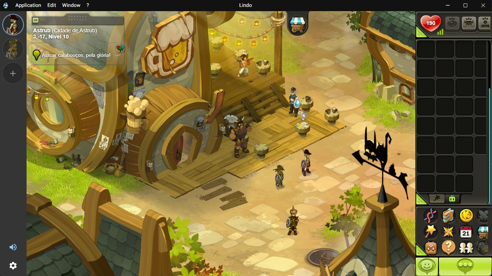

# PC-Touch

**PC-Touch is a community-maintained desktop client for DOFUS Touch, based on the open-source [Lindo No-Emu](https://github.com/prixe/lindo) project.** This fork focuses on restoring compatibility with the current game client and maintaining a usable multi-tab desktop client.

> **Experimental software.** The current reference build is `3.0.0-rc.12-repair.6`. It has been manually exercised on Windows 11 x64 with two accounts. The repository currently provides source code; no distributable installer or portable build has been validated.

PC-Touch is the repository and fork name. The application still identifies itself as **Lindo** in this revision. This fork is independent of Ankama and is not an official client.

## Project status

The following behavior has been confirmed by the maintainer on Windows 11 x64:

- Game update, startup, guest and Ankama login, character selection, and map entry.
- Two accounts in one window, including group play and combat.
- Manual tab switching and automatic tab selection at the start of a character's combat turn.
- Tab portraits, background audio, zaap search, the party prospecting icon, and the in-game store.

Each game window supports up to **four tabs**. Four-account sessions, long sessions, saved-account login, and the complete notification/window-focus settings matrix remain unverified. See the [validation record](docs/testing/validation.md) for evidence and limits.

The regression suite covers application logic using controlled dependencies and simulated environments. The validation record also lists the scenarios exercised in the game.

*Screenshot from PC Touch/Lindo currently running on Windows 11; not representative of a final, fully working release.*

## Getting started

PC-Touch is currently available as source code. Local development uses Node.js 24, Yarn Classic, and the scripts in [package.json](package.json).

## Repository map

| Path | Contents |
| --- | --- |
| `packages/main` | Electron main process, application windows, local server, updater, and persistence. |
| `packages/preload` | The `window.lindoAPI` bridge exposed to renderer contexts. |
| `packages/renderer` | React interface, tabs, preferences, game integration, and optional mods. |
| `packages/shared` | Shared models, settings, shortcut definitions, and IPC event types. |
| `packages/i18n` | Lindo interface translations and generated localization types. |
| `tests` and `scripts` | Regression tests and development/build tooling. |
| `docs` | Project roadmap, test records, and repair history. |

The game client is downloaded at runtime and stored in the application data directory. It is not included in this repository. Generated output, `node_modules`, account profiles, tokens, and game assets do not belong in source commits.

## Contributing and reports

Bug reports and proposed changes are welcome through [GitHub Issues](https://github.com/falcie1337/PC-Touch/issues). Check existing reports first and include the version or commit, platform, steps to reproduce, expected behavior, observed behavior, and sanitized logs. Never post passwords, cookies, OAuth codes, or access/refresh tokens. See [CONTRIBUTING.md](CONTRIBUTING.md) and [SECURITY.md](SECURITY.md).

The [roadmap](docs/project/roadmap.md) tracks maintenance priorities and candidate features. The existing auto-follow code is legacy behavior and has not been adapted or validated by this repair.

## Compatibility

| Platform | Status in this fork |
| --- | --- |
| Windows 11 x64 | Initial manual test platform. Two-account gameplay has been confirmed. |
| Linux | The upstream project contains Linux build configuration, but this fork has not been revalidated on Linux. |
| Other Windows versions, Windows ARM64, and macOS | Not currently validated by this fork. |

## Project links

- [Roadmap](docs/project/roadmap.md)
- [Manual test plan](docs/testing/manual-test-plan.md)
- [Validation record](docs/testing/validation.md)
- [Repair report and file inventory](docs/history/repair-report.md)
- [Changelog](CHANGELOG.md)
- [License](LICENSE)
- [Original Lindo repository](https://github.com/prixe/lindo)

## Disclaimer and licensing

DOFUS Touch, Ankama names, and game assets belong to their respective owners. PC-Touch is not affiliated with or endorsed by Ankama. Ankama's current [device and client policy](https://support.ankama.com/hc/en-us/articles/26840828168209-What-devices-can-I-play-DOFUS-Touch-on) may prohibit modified clients; review the official terms and policies before using this software. The GPL license for this repository does not grant permission to use the game or override Ankama's rules.

This repository retains the original [GPL-3.0](LICENSE) license and upstream attribution. Third-party dependencies and assets remain subject to their respective licenses and terms. The repair work is not a security audit.
